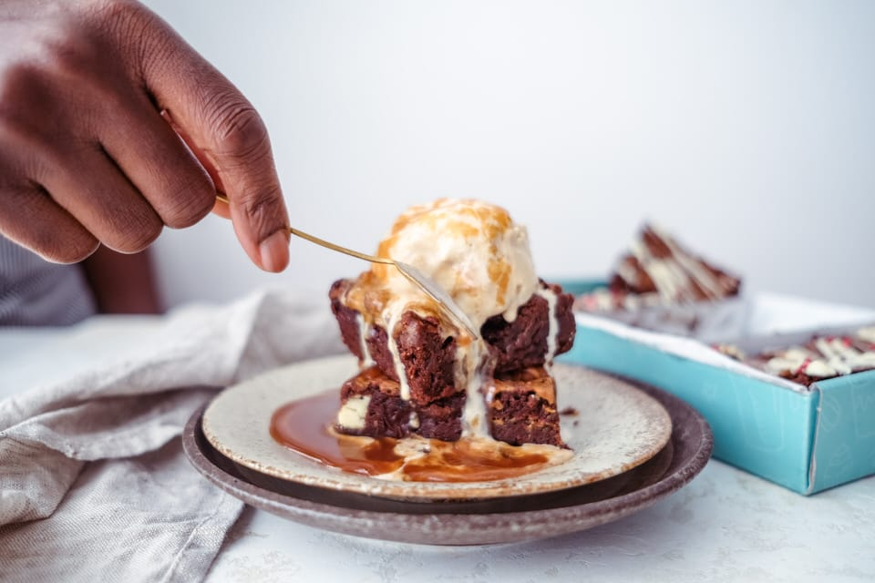
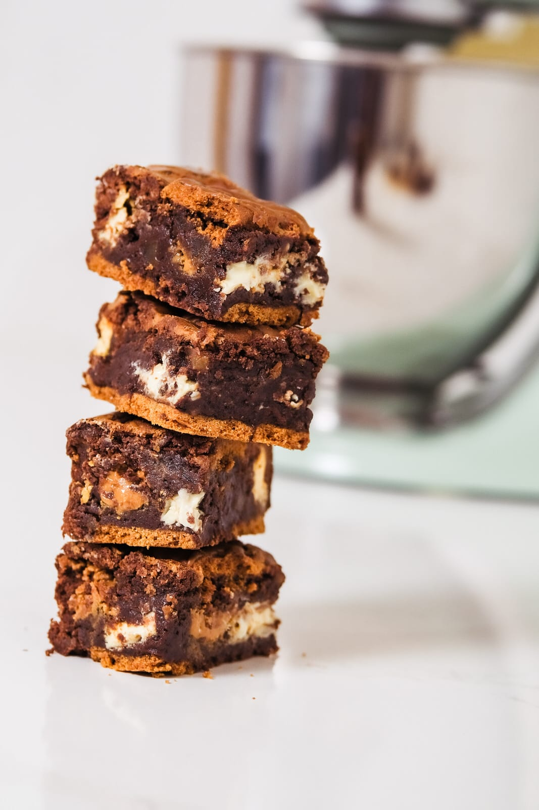
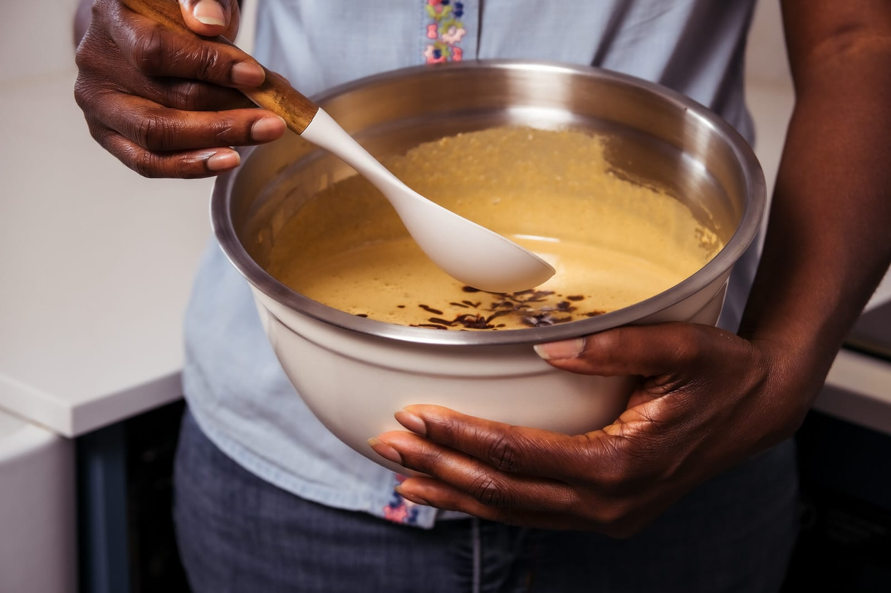
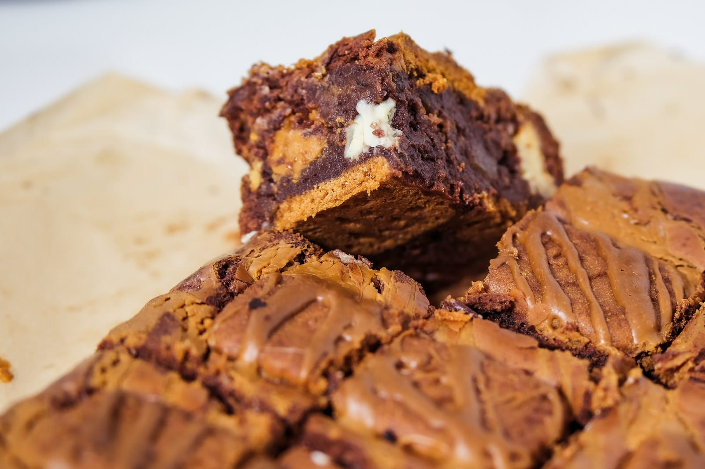

## Decadent brownies made to order from our kitchen to your door

- Strategy
- Custom Design
- Professional photography
- Professional videography
- Custom checkout
- Conditional enquiry forms

## “Baya Garden studio went over and beyond to create an amazing website for my online bakery business.”

Tayo’s Mixing Bowl is a custom handmade brownies and cakes business creating high-end treats for special occasions.

The business ethos is quality over quantity, priding itself on using premium ingredients and traditional baking methods to create decadent and delightful flavours with every mouthful.

Tayo’s love for beautifully crafted baked treats with warm, memorable flavours has rightly earned her the reputation of producing high quality desserts.

When she approached Baya Garden studio, she was ready to move on to the next stage and have a website that reflected her brand values and that beautifully conveyed her craft.

## The Brief

During the discovery phase, Tayo expressed that she wanted her website to showcase the high quality of desserts that she produced and expressed luxury yet with hints of heritage, representing her traditional approach to creating the treats.

She favoured a clean, modern look and emphasised that the shop area needed to be easy to use. Tayo would only be producing small batches of brownies at a time and needed a checkout area that placed a cap on how many brownie boxes could be ordered in a week.

The website also needed enquiry forms that led each customer through a series of questions, depending on whether they were after a custom or a cake from the signature cake collection.

## The Strategy and Design

It was important that we showed off the high quality cakes and brownies that were on offer. After planning the initial layout of the website structure and working through the customer journey, a series of professional photoshoots were carried out with a focus on showcasing the desserts in the best light.

Alongside, the photoshoot, we shot and edited a video of Tayo at work, showcasing the high level of skill and expertise that went into her craft.

The colour palette was taken from Tayo’s Mixing Bowl brand guidelines and formed the foundation of a consistent theme throughout the website.

Conversational forms were incorporated into the site with a focus on good user experience conditionally leading the customer through a series of short questions based on their requirements.  
The checkout area was customised to be inline with the business operations, ensuring a limited quota of brownies could be ordered in a given week.

## The Impact

Here’s what Tayo had to say of her experience with Baya Garden Studio:

“Baya Garden Studios went over and beyond to create an amazing website for my online bakery business. Being a start up business I really wanted my website to convey high end and to appeal to a specific target market.

I had lengthy discussions with Hannah about my company’s vision, product, image and brand and Hannah produced a website that conveyed my brand message. Several friends and acquaintances have also commented on how lovely my website is, has a very clean look and very easy to use.

Hannah is very thorough in her work and I felt that she addressed any concerns I had and came up with solutions that I was happy with. I would definitely recommend Baya Garden Studios to business owners/ start ups that need a website or want to revamp their website.”

