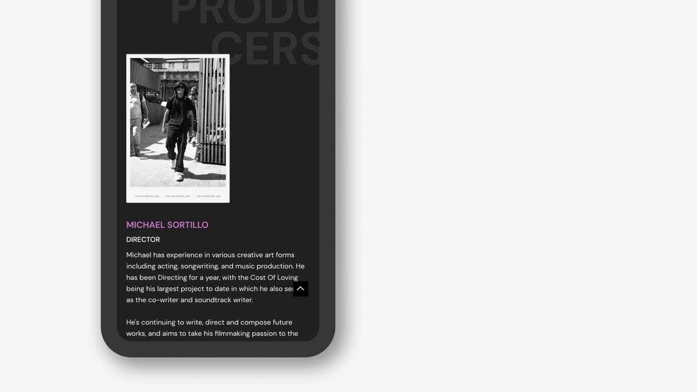

## The company

iTAV (It Takes a Village) is an off-shoot of its parent company, Bridge the Gap Studios, whose mission is to amplify the work of unrepresented creatives in the media industry.

They facilitated a series of workshops, involving script writing, film production and collaborations with established companies, such as Netflix. This culminated in a film festival hosted at the Science Gallery in London and a Gala where winners for creative contributions will be announced and awards given to propel the recipients to the next level of their careers.

<figure class="project-video">
  <video src="/videos/the-itav-film-festival.mp4" autoplay muted loop playsinline controls preload="metadata" aria-label="Screen recording of the iTAV Film Festival website"></video>
</figure>

## The brief

Baya Garden Studio’s involvement in the iTAV project was two-fold. Firstly, high end photography was required showcasing the families surrounding the creatives and at the festival, all visitors are given professional headshots to use as part of their branding.

Secondly, a full design and development of the website was needed to showcase the work of the iTAV, highlight the impact to would-be investors and promote the work of the creatives that were involved in the project.

## The Strategy and Design

A series of discussions were had to decide how best to present the iTAV project in a way that met three objectives: attract new investors, highlight underrepresented creatives and provide a central space where visitors could watch the films and nominate creatives for awards.

Informed by user experience research, above navigation banners, call to action buttons and contrasting layouts were used to encourage visitors to take action on the site.

A light weight, above the fold, video background was chosen to highlight snippets of each film while typography and colours were kept inline with the iTAV brand guidelines.

As the site was going to be maintained by Bridge the Gap, each section was built in a modular fashion with editable graphical elements. All sections for both during and after the project were included so that they could be independently hidden and revealed as the iTAV project evolved.

The iTAV was a pleasure to work with because of their central focus on social impact and the opportunity to work on a creative project.
